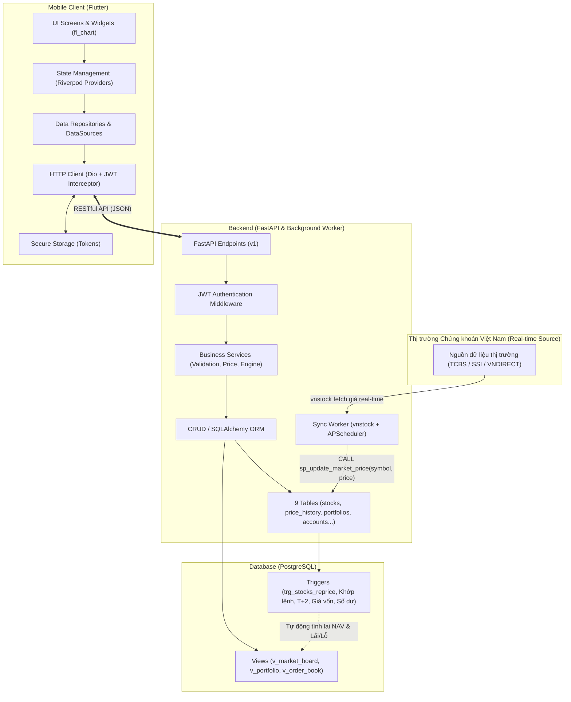

# StockMate — Kế Hoạch Phát Triển Ứng Dụng (Master Project Plan)

> Tài liệu định hướng đầy đủ và lịch sử sprint. Bản đầu hiện triển khai theo
> [MVP_SCOPE](MVP_SCOPE.md), [BUSINESS_RULES](BUSINESS_RULES.md) và [WORK_BOARD](WORK_BOARD.md).
> Điểm bắt đầu và hướng dẫn từng người: [START_HERE](START_HERE.md).
> Mốc 04/10 bên dưới thuộc kế hoạch cũ; nhóm cần điền lịch mới ở WORK_BOARD.

> **Môn học:** Lập trình Thiết bị Di động  
> **Dự án:** StockMate — Ứng dụng giao dịch chứng khoán mô phỏng thị trường Việt Nam (HOSE / HNX / UPCOM)  
> **Quy mô nhóm:** 6 thành viên  
> **Thời gian thực hiện:** 3 Sprint (6 tuần)

---

## 1. Tổng quan Dự án

### 1.1. Mục tiêu dự án
StockMate là ứng dụng di động mô phỏng sàn giao dịch chứng khoán Việt Nam, cung cấp cho nhà đầu tư cá nhân trải nghiệm theo dõi bảng giá thời gian thực, quản lý danh mục đầu tư, đặt lệnh mua/bán cổ phiếu và quản lý tài sản an toàn, trực quan.

Dự án được xây dựng với tiêu chuẩn ứng dụng thực tế:
- **Di động (Frontend):** Đa nền tảng Android/iOS bằng Flutter, kiến trúc phân tầng sạch (Clean Architecture), quản lý trạng thái bằng Riverpod, điều hướng khai báo bằng GoRouter.
- **Máy chủ (Backend):** FastAPI (Python), RESTful API chuẩn OpenAPI/Swagger, xác thực JWT, kiến trúc hướng dịch vụ (Service Layer + Repository/CRUD).
- **Cơ sở dữ liệu (Database):** PostgreSQL 14+, 9 bảng chuẩn hóa, bảo toàn toàn vẹn dữ liệu tài chính với kiểu `NUMERIC`, các trigger xử lý khớp lệnh, cập nhật số dư, tính giá vốn bình quân và lãi/lỗ tự động.
- **Dữ liệu thị trường thời gian thực (Real-time Market Data Sync):** Tích hợp giải pháp tối ưu sử dụng thư viện **`vnstock`** để tự động đồng bộ giá cổ phiếu thực tế (HOSE / HNX / UPCOM) từ các nguồn dữ liệu thị trường Việt Nam (TCBS, SSI, VNDIRECT) vào CSDL PostgreSQL, tự động kích hoạt trigger định giá lại danh mục tài sản người dùng.

### 1.2. Công nghệ sử dụng
| Thành phần | Công nghệ chính | Thư viện / Công cụ bổ trợ |
|---|---|---|
| **Mobile App** | Flutter 3.x, Dart 3.x | `flutter_riverpod`, `go_router`, `dio`, `fl_chart`, `flutter_secure_storage`, `intl`, `equatable` |
| **Backend API**| Python 3.11+, FastAPI | `SQLAlchemy 2.x`, `Pydantic v2`, `passlib[bcrypt]`, `python-jose`, `alembic`, `uvicorn`, `pytest` |
| **Đồng bộ dữ liệu Real-time** | Python Background Worker / APScheduler | **`vnstock` / `vnstock3`** (kết nối nguồn cấp dữ liệu chứng khoán Việt Nam), `httpx` |
| **Database**   | PostgreSQL 14+ | Trigger/Stored Procedures (`sp_update_market_price`), Views tối ưu hóa, Docker Compose |
| **CI/CD & Quản lý** | GitHub Actions, Git Flow | GitHub Projects/Issues, Docker, Postman/Thunder Client |

---

## 2. Kiến trúc Hệ thống & Luồng Dữ liệu Đồng bộ Real-time

---

## 3. Phạm vi Chức năng Toàn diện (Feature Scope)

Dự án hoàn chỉnh gồm 7 phân hệ chức năng:

### 3.1. Phân hệ 1: Xác thực & Người dùng (Authentication & User Profile)
- Đăng ký tài khoản nhà đầu tư mới (họ tên, email, số điện thoại, CCCD).
- Đăng nhập bảo mật (JWT Access Token + Refresh Token).
- Quản lý phiên làm việc, tự động gia hạn token (Refresh Token interceptor).
- Xem và chỉnh sửa thông tin cá nhân, cài đặt bảo mật, đổi mật khẩu.
- Hỗ trợ tài khoản Tiền mặt (Cash) và Ký quỹ (Margin).

### 3.2. Phân hệ 2: Thị trường & Bảng giá Thời gian thực (Real-time Market & Stock Detail)
- **Cơ chế đồng bộ giá thực tế:** Tích hợp thư viện `vnstock` chạy worker định kỳ (mỗi 5-10 giây trong phiên giao dịch hoặc triggered), lấy giá thị trường thực tế của các mã niêm yết (VCB, FPT, HPG, SSI, ...) và cập nhật vào bảng `stocks`.
- Khi giá thị trường thay đổi, gọi stored procedure `sp_update_market_price()` ➔ Database trigger `trg_stocks_reprice` tự động tính toán lại giá trị tài sản ròng (NAV) và lãi/lỗ của tất cả người dùng nắm giữ mã đó.
- Bảng giá trực tuyến phân loại theo sàn giao dịch (HOSE, HNX, UPCOM).
- Màu sắc tuân thủ nghiêm ngặt quy ước chứng khoán Việt Nam:
  - Tím (Trần), Xanh lơ (Sàn), Vàng (Tham chiếu), Xanh lá (Tăng giá), Đỏ (Giảm giá).
- Tìm kiếm và lọc mã cổ phiếu theo mã, tên doanh nghiệp hoặc ngành nghề.
- Trang chi tiết cổ phiếu: Chỉ số tài chính, biểu đồ biến động giá tương tác (Line/Candlestick chart qua `fl_chart`), lịch sử giá OHLCV.

### 3.3. Phân hệ 3: Danh mục Theo dõi (Watchlist)
- Hiển thị danh sách các mã cổ phiếu người dùng quan tâm.
- Thêm/Xóa nhanh mã chứng khoán vào danh mục theo dõi từ màn hình bảng giá hoặc chi tiết.
- Cập nhật biến động giá của danh mục theo dõi tức thời theo dữ liệu thị trường mới nhất.

### 3.4. Phân hệ 4: Đặt lệnh & Giao dịch (Order Placement & Matching)
- Hỗ trợ các loại lệnh phổ biến: Lệnh giới hạn (`LO`), lệnh thị trường mở phiên (`ATO`), đóng phiên (`ATC`).
- Giao diện đặt lệnh trực quan với tính toán tự động:
  - Kiểm tra sức mua (Cash balance / Margin limit).
  - Kiểm tra biên độ giá hợp lệ (Sàn <= Giá đặt <= Trần theo giá real-time).
  - Kiểm tra lô chẵn (Bội số 100 theo quy định sàn HOSE).
  - Tự động phong tỏa số tiền tương ứng khi đặt lệnh Mua.
  - Tự động phong tỏa số lượng cổ phiếu khả dụng khi đặt lệnh Bán.
- Hủy lệnh chờ khớp (`PENDING`) và giải tỏa số dư/cổ phiếu ngay lập tức.

### 3.5. Phân hệ 5: Khớp lệnh & Quản lý Tài sản (Portfolio & Asset Valuation)
- Mô phỏng khớp lệnh tức thì hoặc theo điều kiện giá thị trường real-time.
- Kích hoạt trigger PostgreSQL tự động:
  - Sinh bản ghi lịch sử `transactions`.
  - Cập nhật số dư tiền thực tế và tiền phong tỏa.
  - Cập nhật số lượng cổ phiếu sở hữu, tính toán lại **Giá vốn bình quân** (Average Cost).
  - Khấu trừ phí giao dịch (0.15%) và thuế TNCN (0.1% khi bán).
  - Quản lý ngày thanh toán bù trừ T+2.
- Màn hình Tổng quan Tài sản (Dashboard):
  - Tổng tài sản ròng (NAV), Tiền mặt khả dụng, Tiền chờ về, Tạm tính lãi/lỗ danh mục theo giá thị trường real-time.
- Màn hình Danh mục đầu tư (Portfolio):
  - Chi tiết từng mã sở hữu: Khối lượng nắm giữ, Khối lượng khả dụng, Giá vốn, Giá hiện tại (real-time), Lãi/Lỗ (+/-% và VND).

### 3.6. Phân hệ 6: Sổ lệnh & Lịch sử Giao dịch (Order Book & History)
- Sổ lệnh trong ngày: Danh sách lệnh đang chờ khớp, đã khớp một phần/toàn bộ, đã hủy.
- Lịch sử giao dịch: Báo cáo đầy đủ mọi giao dịch mua/bán đã hoàn tất kèm phí, thuế và thời gian thực hiện.

### 3.7. Phân hệ 7: Trung tâm Thông báo (Notifications)
- Nhận thông báo tự động khi:
  - Lệnh đặt thành công / Lệnh đã khớp hoàn toàn.
  - Biến động số dư tài khoản tiền và danh mục cổ phiếu khi thị trường biến động mạnh.
- Đánh dấu đã đọc, xóa thông báo.

---

## 4. Lộ trình Triển khai Chi tiết theo 3 Sprint (Roadmap)

### 4.1. Sprint 1 (Tuần 1 – 2): CSDL, Khung Ứng dụng & Xác thực
- **Mục tiêu:** Thiết lập nền tảng hạ tầng, CSDL quan hệ 9 bảng + triggers, khung Flutter và FastAPI, hoàn thành chức năng Đăng ký / Đăng nhập.
- **Mốc hoàn thành:** 04/10.

### 4.2. Sprint 2 (Tuần 3 – 4): Thị trường, Bảng giá, Đồng bộ Real-time `vnstock` & Quản lý Tài sản
- **Mục tiêu:** 
  - Tích hợp thư viện `vnstock` vào Backend và viết background worker đồng bộ giá thị trường thực tế định kỳ vào PostgreSQL.
  - Xây dựng cụm API: Account, Portfolio, Stock, Search, StockPriceHistory, Watchlist.
  - Mobile: Hoàn thiện Dashboard tài sản, Portfolio, Stock Detail (biểu đồ `fl_chart`), Watchlist và tích hợp dữ liệu thật từ Backend.
- **Mốc hoàn thành:** Cuối tuần 4.

### 4.3. Sprint 3 (Tuần 5 – 6): Đặt lệnh, Khớp lệnh Tự động, CI/CD & Kiểm thử E2E
- **Mục tiêu:** 
  - Hoàn thiện nghiệp vụ đặt lệnh Mua/Bán theo giá real-time, khớp lệnh tự động, tính phí/thuế/T+2.
  - Màn hình Sổ lệnh, Lịch sử giao dịch, Profile và Thông báo.
  - Thiết lập CI/CD pipeline, build APK/Web demo, kiểm thử E2E toàn diện và hoàn tất báo cáo lớn.
- **Mốc hoàn thành:** Cuối tuần 6.

---

## 5. Tiêu chí Hoàn thành (Definition of Done - DoD)

1. **Mã nguồn (Code Quality):**
   - Clean code, không cảnh báo nghiêm trọng từ `flutter analyze` và linter Python.
   - Toàn bộ số tiền và giá dùng kiểu `NUMERIC` / `Decimal`, tuyệt đối không dùng `float`.
2. **Đồng bộ dữ liệu Real-time:**
   - Worker `vnstock` hoạt động ổn định, có cơ chế bắt ngoại lệ khi sàn ngoài bị timeout/nghẽn mạng, không làm gián đoạn API server.
   - Khi giá thay đổi, view `v_market_board` và `v_account_summary` phản ánh đúng giá trị mới mà không cần restart server.
3. **Trải nghiệm người dùng (UX):**
   - Đầy đủ trạng thái Loading, Empty, Error.
   - Màu sắc bảng giá chuẩn: Tím/Xanh lơ/Vàng/Xanh lá/Đỏ.
4. **Tích hợp & Báo cáo:**
   - Đã kiểm thử trên thiết bị thật / Android Emulator.
   - Hoàn thành đầy đủ các sơ đồ UML và thuyết minh theo phân công.
