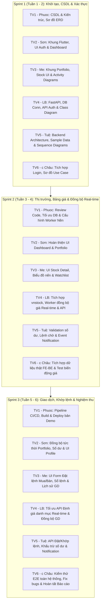

# Bảng Phân Công Nhiệm Vụ 6 Thành Viên — Dự Án StockMate

> **Hướng dẫn thực thi:** [START_HERE](START_HERE.md), [WORK_BOARD](WORK_BOARD.md),
> [FILE_OWNERS](FILE_OWNERS.md) và thư mục `docs/team/`. CSV gốc không có trong repo.
> Phân công sprint dưới đây giữ làm định hướng; task ID và phạm vi MVP mới có ưu tiên khi khác nhau.
> **Dự án:** Ứng dụng Giao dịch Chứng khoán StockMate  
> **Quy mô:** 6 thành viên (TV1 – TV6)  
> **Lộ trình:** 3 Sprint (Sprint 1: Tuần 1-2 | Sprint 2: Tuần 3-4 | Sprint 3: Tuần 5-6)

---

## 1. Danh sách Thành viên & Phân vai Trách nhiệm (Role & Responsibility)

| STT | Mã TV | Họ và tên / Ký hiệu | Vai trò chính trong dự án | Trách nhiệm trọng tâm |
|:---:|:---:|:---|:---|:---|
| 1 | **TV1** | **Phuoc** | **Project Leader / DevOps & DB Lead** | Thiết kế CSDL, quản lý tiến độ, review code, thiết lập CI/CD, hạ tầng background worker cho đồng bộ dữ liệu, đóng gói APK/Web. |
| 2 | **TV2** | **Sơn** | **Frontend Lead (UI/UX & State)** | Khởi tạo Flutter, dựng khung app, màn hình Auth, Dashboard tài sản, Portfolio và Profile cá nhân. |
| 3 | **TV3** | **Me** | **Frontend Core Developer (Market & Orders)** | Màn hình Bảng giá, Chi tiết mã cổ phiếu, Biểu đồ giá (`fl_chart`), Watchlist, Form Đặt lệnh Mua/Bán & Lịch sử giao dịch. |
| 4 | **TV4** | **LB** | **Backend Lead (Core API & Real-time Data Sync)** | Khởi tạo FastAPI, cấu hình DB, cụm API Auth, Account, Portfolio, Stock, Watchlist. **Chịu trách nhiệm tích hợp thư viện `vnstock` và viết worker đồng bộ giá thị trường real-time vào PostgreSQL**. |
| 5 | **TV5** | **Tuệ** | **Backend Trading Engine & Business Logic** | Cấu trúc module Order/Transaction, logic kiểm tra điều kiện (sức mua, biên độ), trigger khớp lệnh và Notification API. |
| 6 | **TV6** | **c Châu** | **QA / QC, Integration & Project Reporter** | Tích hợp dữ liệu giữa FE và BE, kiểm thử End-to-End (E2E), kiểm thử luồng cập nhật giá real-time, hoàn thiện tài liệu báo cáo lớn. |

---

## 2. Kế hoạch Phân công Chi tiết Theo Từng Sprint

---

### Sprint 1 (Tuần 1 – 2): CSDL, Khung Ứng dụng & Xác thực (Hạn chót: 04/10)

| Thành viên | Phân loại | Nội dung công việc chi tiết | Sản phẩm bàn giao (Deliverables) |
|---|---|---|---|
| **TV1 - Phuoc** | **Phát triển** | - Phân tích yêu cầu chi tiết & đặc tả luồng nghiệp vụ thị trường. - Thiết kế lược đồ ERD chuẩn hóa 9 bảng dữ liệu. - Khởi tạo CSDL PostgreSQL và script chạy tự động (`00_run_all.sql`). - Thiết lập GitHub repo, nhánh bảo vệ, quy ước commit và branching. | - Mã nguồn `data/postgres/` (00 đến 09) - Repository GitHub chuẩn hóa |
| | **Viết báo cáo** | - Mục **2.3.1. Thiết kế CSDL mức khái niệm**. - Vẽ và thuyết minh sơ đồ **ERD** (Entity-Relationship Diagram). | - Nội dung mục 2.3.1 trong file báo cáo Word/Markdown |
| **TV2 - Sơn** | **Phát triển** | - Khởi tạo dự án Flutter với cấu trúc phân tầng (`core/`, `data/`, `features/`). - Cài đặt và cấu hình thư viện `flutter_riverpod`, `go_router`, `flutter_secure_storage`. - Xây dựng khung giao diện Đăng nhập (Login) & Khung Dashboard. | - Source code `mobile/lib/` (Auth UI, Dashboard skeleton) |
| | **Viết báo cáo** | - Hỗ trợ tài liệu hướng dẫn cài đặt và thiết lập Flutter Client. | - Tài liệu hướng dẫn cài đặt Frontend |
| **TV3 - Me** | **Phát triển** | - Tạo khung giao diện Danh mục (Portfolio) & Màn hình Cổ phiếu (Stock) cơ bản. - Xây dựng hệ thống điều hướng `go_router` với Bottom Navigation Bar 4 tab:   *Thị trường - Danh mục - Giao dịch - Tài khoản*. | - Code routing & khung giao diện Navigation trong `mobile/lib/` |
| | **Viết báo cáo** | - **Sơ đồ Hoạt động (Activity Diagram)**: Luồng Đăng ký / Đăng nhập. - **Sơ đồ Hoạt động (Activity Diagram)**: Luồng đặt lệnh Mua/Bán (nhập KL, giá, điều kiện xác nhận). | - 2 Sơ đồ Activity Diagram xuất ảnh sắc nét kèm mô tả luồng rẽ nhánh |
| **TV4 - LB** | **Phát triển** | - Khởi tạo dự án Backend FastAPI (`backend/app`). - Kết nối CSDL PostgreSQL qua SQLAlchemy và Alembic migration. - Xây dựng endpoint xác thực ban đầu: `POST /api/auth/register`, `POST /api/auth/login`. | - Mã nguồn Backend API Auth trong `backend/app/api/v1/endpoints/auth.py` |
| | **Viết báo cáo** | - Mục **2.3.2. Thiết kế CSDL mức logic** (Thiết kế lược đồ quan hệ, chuẩn hóa 3NF, xác định khóa chính/ngoại). - Vẽ và đặc tả **Sơ đồ Lớp (Class Diagram)** của hệ thống. | - Nội dung mục 2.3.2 kèm Sơ đồ Lớp (Class Diagram) |
| **TV5 - Tuệ** | **Phát triển** | - Thiết lập cấu trúc module Order & Transaction trong Backend. - Xây dựng bộ dữ liệu mẫu (Seed Data) chuẩn xác cho môi trường test. - Thiết lập môi trường test tự động (`pytest`). | - Script `seed_trading.sql`, cấu trúc `backend/app/models/` |
| | **Viết báo cáo** | - Mục **2.3.3. Thiết kế CSDL mức vật lý** (Bảng, kiểu dữ liệu, index, ràng buộc toàn vẹn). - **Sơ đồ Tuần tự (Sequence Diagram 1)**: Luồng khớp lệnh Mua, cập nhật số dư/cổ phiếu và đẩy thông báo. - **Sơ đồ Tuần tự (Sequence Diagram 2)**: Luồng tương tác Client - Backend - CSDL cho Đăng ký & Đăng nhập. | - Mục 2.3.3 trong báo cáo và 2 Sơ đồ Sequence Diagram hoàn chỉnh |
| **TV6 - c Châu** | **Phát triển** | - Kết nối Frontend và Backend cho chức năng Đăng ký / Đăng nhập (tích hợp token JWT). - Kiểm tra đồng bộ môi trường phát triển của 6 thành viên, giải quyết xung đột cấu hình. | - Luồng Login hoàn chỉnh chạy được từ Flutter gọi tới FastAPI |
| | **Viết báo cáo** | - Vẽ **Sơ đồ Use Case tổng thể**: Tác nhân (Khách hàng, Hệ thống) và các phân hệ. - Vẽ **Sơ đồ Use Case chi tiết**: Phân hệ Xác thực người dùng (Login, Register, Refresh Token). | - 2 Sơ đồ Use Case kèm bảng đặc tả kịch bản Use Case |

---

### Sprint 2 (Tuần 3 – 4): Thị trường, Bảng giá, Đồng bộ Real-time `vnstock` & Quản lý Tài sản

| Thành viên | Phân loại | Nội dung công việc chi tiết | Sản phẩm bàn giao (Deliverables) |
|---|---|---|---|
| **TV1 - Phuoc** | **Phát triển** | - Quản lý tiến độ tuần, tổ chức review code Backend & Frontend. - Đảm bảo toàn bộ code tuân thủ quy ước kiểu dữ liệu (`Decimal` / `NUMERIC`). - Tối ưu hóa truy vấn CSDL và chỉ mục (Index) trên các Views: `v_market_board`, `v_watchlist_detail`, `v_portfolio_detail`. - **Hỗ trợ cấu hình môi trường chạy tiến trình nền (Background Worker / Daemon / Docker)** cho script đồng bộ dữ liệu `vnstock`. | - PR reviews trên GitHub - Các bản tối ưu hóa SQL indexes - Cấu hình chạy worker nền |
| | **Viết báo cáo** | - Viết mục Đánh giá hiệu năng và chiến lược tối ưu hóa CSDL & quản lý tiến trình nền. | - Mục Tối ưu CSDL trong báo cáo |
| **TV2 - Sơn** | **Phát triển** | - Hoàn thiện màn hình Dashboard: Thẻ tổng tài sản ròng (NAV), số dư tiền khả dụng, tiền chờ về, biểu đồ tỷ trọng. - Hoàn thiện giao diện Portfolio: Danh sách cổ phiếu nắm giữ, hiển thị màu sắc lãi/lỗ theo chuẩn Việt Nam. | - Code các màn hình tại `mobile/lib/features/home/` & `portfolio/` |
| | **Viết báo cáo** | - Tài liệu hóa cấu trúc State Management sử dụng Riverpod cho Dashboard & Portfolio. | - Mục Thiết kế Frontend Architecture |
| **TV3 - Me** | **Phát triển** | - Xây dựng chức năng Tìm kiếm cổ phiếu theo mã, tên doanh nghiệp. - Xây dựng màn hình Stock Detail hiển thị thông tin 3 sàn (HOSE, HNX, UPCOM). - Tích hợp biểu đồ giá tương tác sử dụng thư viện `fl_chart` (lịch sử giá OHLCV). - Xây dựng giao diện danh mục quan tâm (Watchlist) với nút thêm/xóa nhanh. | - Màn hình `features/market/` & `features/watchlist/` |
| | **Viết báo cáo** | - Mô tả thiết kế giao diện người dùng (UI/UX Specification) cho Phân hệ Thị trường. | - Mục Thiết kế UI/UX Thị trường |
| **TV4 - LB** | **Phát triển** | - **TÍCH HỢP ĐỒNG BỘ DỮ LIỆU REAL-TIME:**   1. Cài đặt thư viện `vnstock` / `vnstock3` vào `backend/requirements.txt`.   2. Viết background worker (`backend/scripts/sync_market_data.py` hoặc scheduler service với `APScheduler`) định kỳ fetch giá thực tế từ nguồn TCBS/SSI/VNDIRECT.   3. Gọi Stored Procedure `CALL sp_update_market_price(symbol, price)` để đồng bộ vào bảng `stocks` và tự động kích hoạt trigger `trg_stocks_reprice` tính lại lãi/lỗ danh mục. - Phát triển các API:   * `GET /api/market/board` (Bảng giá real-time)   * `GET /api/stocks/{symbol}` & `/chart` (Chi tiết & biểu đồ)   * `GET /api/accounts` & `/{id}/assets` (Tài khoản)   * `GET /api/accounts/{id}/portfolio` (Danh mục)   * `GET/POST/DELETE /api/watchlist` (Watchlist). | - Thư viện `vnstock` trong requirements - Worker script `backend/scripts/sync_market_data.py` - Các file endpoints trong `backend/app/api/v1/endpoints/` |
| | **Viết báo cáo** | - Cập nhật tài liệu API Spec (Tích hợp Swagger OpenAPI). - Tài liệu hóa giải pháp kỹ thuật đồng bộ dữ liệu thời gian thực sử dụng `vnstock`. | - Bộ sưu tập Postman / Swagger docs - Phần Thuyết minh Giải pháp Real-time Data Sync |
| **TV5 - Tuệ** | **Phát triển** | - Xây dựng logic kiểm tra điều kiện tài khoản (kiểm tra số dư khả dụng, hạn mức ký quỹ margin theo giá thị trường real-time). - Thiết lập cấu trúc lưu trữ và xử lý lệnh chờ (`PENDING`). - Xây dựng mô hình sự kiện và tạo bản ghi thông báo hệ thống (`notifications`). | - Services trong `backend/app/services/` |
| | **Viết báo cáo** | - Đặc tả logic nghiệp vụ kiểm tra điều kiện đặt lệnh và quản trị rủi ro tài khoản. | - Mục Đặc tả Nghiệp vụ Giao dịch |
| **TV6 - c Châu** | **Phát triển** | - Tích hợp dữ liệu thật từ Backend API vào giao diện Frontend cho 3 phân hệ: Dashboard, Stock/Market Board và Watchlist. - **Kiểm thử tính năng đồng bộ giá thời gian thực:** Kiểm tra khi worker cập nhật giá một mã cổ phiếu (ví dụ `FPT`, `HPG`), kiểm tra xem bảng giá và tài sản trên app có tự động cập nhật đúng không. - Bắt lỗi kết nối mạng, xử lý các trạng thái: Loading Skeleton, Empty State, Error State. | - Bản build Flutter chạy mượt mà dữ liệu thật từ Backend - Kết quả kiểm thử đồng bộ dữ liệu real-time |
| | **Viết báo cáo** | - Viết tài liệu kiểm thử tích hợp (Integration Test Cases) cho Sprint 2. | - Bảng kịch bản Test Cases Sprint 2 |

---

### Sprint 3 (Tuần 5 – 6): Đặt lệnh, Khớp lệnh Tự động, CI/CD & Nghiệm thu Toàn diện

| Thành viên | Phân loại | Nội dung công việc chi tiết | Sản phẩm bàn giao (Deliverables) |
|---|---|---|---|
| **TV1 - Phuoc** | **Phát triển** | - Chuẩn bị môi trường deploy: Container hóa Backend với Docker (chạy song song API server + worker đồng bộ dữ liệu), host CSDL Cloud/Local. - Thiết lập pipeline CI/CD GitHub Actions: Tự động chạy `flutter test` và `pytest` khi tạo PR. - Build và xuất bản phiên bản demo hoàn chỉnh: File APK cho Android / Web Demo. | - File `stockmate.apk` - Pipeline `.github/workflows/` - Docker Compose hoàn chỉnh |
| | **Viết báo cáo** | - Tổng hợp báo cáo kỹ thuật, viết phần Triển khai hệ thống (Deployment Guide). | - Mục Triển khai & Vận hành |
| **TV2 - Sơn** | **Phát triển** | - Lập trình cơ chế đồng bộ tức thời: Tự động cập nhật lại Portfolio và số dư tiền mặt ngay khi đặt lệnh thành công (Reactive state with Riverpod). - Hoàn thiện màn hình Profile cá nhân: Đổi mật khẩu, xem thông tin CCCD, đăng xuất an toàn. | - Mã nguồn `features/profile/` và các State Listeners trong Flutter |
| | **Viết báo cáo** | - Viết hướng dẫn sử dụng ứng dụng cho người dùng cuối (User Manual). | - Mục Hướng dẫn sử dụng app |
| **TV3 - Me** | **Phát triển** | - Xây dựng giao diện Form Đặt lệnh Mua/Bán chuyên nghiệp (nhập khối lượng lô chẵn, giá bước nhảy, phím tắt giá Trần/Sàn/TC lấy từ giá real-time). - Hiển thị màn hình Sổ lệnh trong ngày (danh sách lệnh chờ, hủy lệnh). - Xây dựng màn hình Lịch sử giao dịch (Transaction History) kèm chi tiết phí và thuế. | - Màn hình `features/order/` & `features/transaction/` |
| | **Viết báo cáo** | - Hoàn thiện các ảnh chụp màn hình minh họa (Mockups & Screenshots) cho báo cáo. | - Bộ ảnh UI chất lượng cao cho báo cáo |
| **TV4 - LB** | **Phát triển** | - Tối ưu hóa API định giá danh mục đầu tư theo thời gian thực kết hợp với luồng dữ liệu `vnstock`. - Xử lý cơ chế đồng bộ dữ liệu giao dịch và cập nhật giá vốn bình quân. - Xây dựng endpoint lấy lịch sử giao dịch: `GET /api/accounts/{id}/transactions`. | - Endpoints transactions và định giá real-time trong Backend |
| | **Viết báo cáo** | - Viết mục Tổng kết API và kiến trúc tầng dữ liệu Backend. | - Mục Báo cáo Kiến trúc Backend |
| **TV5 - Tuệ** | **Phát triển** | - Xây dựng API đặt lệnh mua/bán: `POST /api/accounts/{id}/orders`. - Xây dựng API hủy lệnh: `DELETE /api/orders/{id}`. - Hoàn thiện trigger khớp lệnh tự động, tính phí 0.15%, thuế 0.1% và kích hoạt gửi thông báo qua API `GET/POST /api/notifications`. | - Toàn bộ luồng nghiệp vụ khớp lệnh hoạt động trơn tru trong DB & API |
| | **Viết báo cáo** | - Đặc tả chi tiết cơ chế Triggers, Stored Procedures và tính toán T+2. | - Mục Triggers & Nghiệp vụ Khớp lệnh |
| **TV6 - c Châu** | **Phát triển** | - Thực hiện kiểm thử toàn bộ hệ thống End-to-End (E2E Test) trên cả Android Emulator và máy thật. - Ghi nhận, phân loại và phối hợp với các thành viên xử lý triệt để 100% bugs phát sinh. - Chuẩn bị kịch bản demo cho buổi báo cáo với giảng viên. | - Bảng Bug Tracking (Đã fix 100%) - Kịch bản Demo trực tiếp (Demo Script) |
| | **Viết báo cáo** | - Tổng hợp toàn bộ các mục báo cáo thành file Báo cáo Bài tập lớn hoàn chỉnh. - Soạn thảo Slide thuyết trình PowerPoint/Canva chuyên nghiệp. | - Báo cáo tổng thể hoàn chỉnh (PDF/DOCX) - Slide báo cáo đồ án |

---

## 3. Bảng Ma Trận Nhiệm Vụ 6 Thành Viên (RACI Matrix)

*Quy ước:*
- **R (Responsible):** Người trực tiếp thực hiện công việc.
- **A (Accountable):** Người chịu trách nhiệm phê duyệt và chất lượng cuối cùng.
- **C (Consulted):** Người được tham vấn, phối hợp kỹ thuật.
- **I (Informed):** Người được cập nhật tiến độ.

| Hạng mục công việc / Tính năng | TV1 (Phuoc) | TV2 (Sơn) | TV3 (Me) | TV4 (LB) | TV5 (Tuệ) | TV6 (Châu) |
|---|:---:|:---:|:---:|:---:|:---:|:---:|
| **CSDL, Schemas, Triggers & Views** | **A/R** | I | I | C | C | I |
| **Đồng bộ Dữ liệu Thị trường Real-time (`vnstock`)** | C | I | I | **A/R** | C | C |
| **Kiến trúc Flutter & Global State (Riverpod)** | C | **A/R** | C | I | I | I |
| **Màn hình Auth & Dashboard Tài sản** | I | **A/R** | I | C | I | C |
| **Bảng giá, Chi tiết mã, Biểu đồ & Watchlist UI** | I | I | **A/R** | C | I | C |
| **Backend Core, Auth API, Market & Account API** | C | I | I | **A/R** | C | I |
| **Trading Engine, Validation & Khớp lệnh Trigger** | C | I | C | C | **A/R** | I |
| **Form Đặt lệnh, Sổ lệnh & Lịch sử GD UI** | I | C | **A/R** | I | C | C |
| **Tích hợp Frontend - Backend (Full Flow)** | C | C | C | C | C | **A/R** |
| **CI/CD Pipeline & Build Demo (APK/Web)** | **A/R** | I | I | I | I | C |
| **Kiểm thử E2E, Bugfix & Kịch bản Demo** | C | C | C | C | C | **A/R** |
| **Tổng hợp Báo cáo Toàn văn & Slide Đồ án** | C | I | I | I | I | **A/R** |

---
