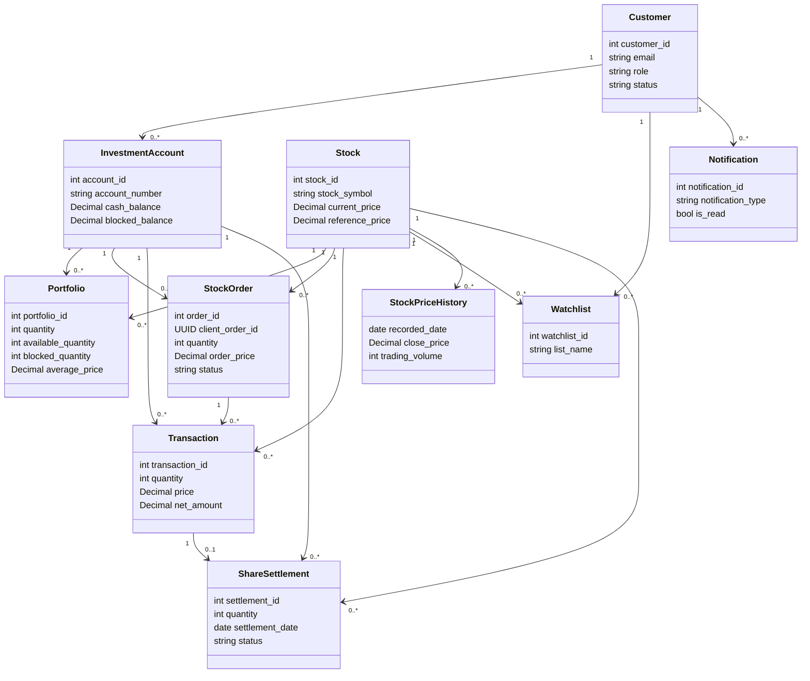
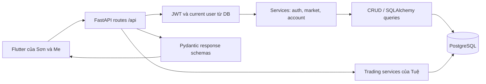

# Phần báo cáo TV4 — LB: CSDL logic, Class Diagram và backend API

Ngày cập nhật: 04/11/2026. Phạm vi: backend demo theo PLAN/MVP_SCOPE.
Nguồn: SQL migration, ORM, API_CONTRACT và code thực thi trong `backend/app/`.
Đây là phần báo cáo của LB để Châu ghép; không thay phần ERD khái niệm của Phuoc hoặc
CSDL vật lý/Sequence giao dịch của Tuệ.

## 1. Thiết kế CSDL logic

Schema hiện hành có 10 bảng nghiệp vụ. PK là khóa chính; FK là khóa ngoại;
UQ là ràng buộc duy nhất. ID dùng BIGINT, tiền dùng NUMERIC/Decimal, không float.

| Quan hệ | PK | FK | Thuộc tính và UQ chính |
|---|---|---|---|
| customers | customer_id | — | full_name, email UQ, phone_number UQ, password_hash, role, status, thông tin hồ sơ, timestamps |
| investment_accounts | account_id | customer_id → customers | account_number UQ, account_type, cash_balance, blocked_balance, total_asset_value, margin_limit, status |
| stocks | stock_id | — | stock_symbol UQ, company_name, exchange, industry, listed_shares, giá hiện tại/tham chiếu/trần/sàn, total_volume, status, updated_at |
| portfolios | portfolio_id | account_id → accounts; stock_id → stocks | quantity, available_quantity, blocked_quantity, average_price, current_value, profit_loss; UQ(account_id, stock_id) |
| stock_orders | order_id | account_id → accounts; stock_id → stocks | client_order_id UUID, BUY/SELL, order_kind, quantity, filled_quantity, order_price, status, reject_reason, timestamps; UQ(account_id, client_order_id) |
| transactions | transaction_id | order_id → orders; account_id → accounts; stock_id → stocks | transaction_type, quantity, price, total_amount, transaction_fee, tax_amount, net_amount, transaction_date, settlement_date |
| share_settlements | settlement_id | transaction_id → transactions UQ; account_id → accounts; stock_id → stocks | quantity, settlement_date, PENDING/SETTLED, settled_at |
| watchlists | watchlist_id | customer_id → customers; stock_id → stocks | list_name, target_price, note; UQ(customer_id, stock_id, list_name) |
| stock_price_history | price_history_id | stock_id → stocks | recorded_date, open/close/highest/lowest_price, trading_volume/value; UQ(stock_id, recorded_date) |
| notifications | notification_id | customer_id → customers | title, content, notification_type, ref_id, is_read, created_at |

Các quan hệ gắn với khóa ID thay vì dùng tên/email làm FK. Hồ sơ khách hàng tách khỏi tài khoản
đầu tư để một khách hàng có nhiều tài khoản. Danh mục tách khỏi bảng mã cổ phiếu để mỗi tài khoản
có khối lượng/giá vốn riêng. Lệnh đặt và giao dịch khớp là hai quan hệ riêng; ledger T+2 gắn từng
lô mua với giao dịch để xác định ngày cổ phiếu về. Lịch sử giá tách theo mã/ngày để lấy nến.

Các ràng buộc chính: email/SĐT/số tài khoản/mã cổ phiếu không trùng; số dư tiền không âm;
available và blocked không âm, tổng không vượt quantity; ngày/mã lịch sử giá không trùng.
DDL chuẩn và migration do Phuoc/Tuệ quản lý; LB dùng chúng cho ORM/query và test PostgreSQL.

`current_value`, `profit_loss`, `total_asset_value` có cột lưu phục vụ engine/SQL gốc, nhưng API
đọc của LB tính lại từ giá hiện hành trong DB. Điều này bảo đảm response không phụ thuộc vào
việc một cột tổng hợp cũ đã được cập nhật hay chưa.

## 2. Class Diagram

Các lớp tương ứng ORM trong `backend/app/models/`. ShareSettlement thuộc TV5;
StockResponse/CandleResponse/AssetResponse/PortfolioResponse/WatchlistResponse là DTO của LB,
không phải bảng DB và không tự ghi thay đổi số dư.

## 3. Kiến trúc backend

- `main.py` dựng app, CORS, root health, router và error handlers.
- `core/config.py` đọc environment/backend `.env`; `core/security.py` hash bcrypt và JWT.
- `api/deps.py` xác thực access JWT rồi đọc customer hiện tại; quyền không lấy từ role token cũ.
- `db/session.py` cấp SQLAlchemy session theo request và đóng khi kết thúc.
- `endpoints/` nhận query/body, dùng dependency và gọi service/query.
- `crud/market.py`, `crud/accounts.py`, `crud/watchlist.py` giữ truy vấn/ownership/order/lock.
- `services/` xử lý transaction đăng ký, định giá và mapping quote/danh mục.
- `schemas/` định nghĩa response có hợp đồng rõ ràng; tiền serialize bằng Decimal HALF_UP.
- `scripts/export_openapi.py` lấy OpenAPI từ chính app; `--check` đối chiếu snapshot trong CI.

Auth CP1 tạo customer + CASH account + 1 tỷ trong một transaction. JWT có sub/type/iat/exp;
access 15 phút, refresh 14 ngày. Refresh không dùng làm access. Logout xóa token ở thiết bị;
demo chưa có rotate/revoke refresh phía server.

## 4. API phần LB

| Nhóm | Endpoint | Hành vi |
|---|---|---|
| Health | GET /health/live, /health/ready | Process sống; DB sẵn sàng hoặc 503 an toàn |
| Auth | POST /api/auth/register, /login, /refresh; GET /api/auth/me | Tạo tài khoản và quản lý phiên JWT |
| Accounts | GET /api/accounts | Tài khoản thuộc customer của JWT |
| Assets | GET /api/accounts/{id}/assets | Cash/blocked/stock value/NAV và lãi lỗ |
| Portfolio | GET /api/accounts/{id}/portfolio | Danh mục phẳng, chỉ giữ quantity > 0 |
| Market | GET /api/market/board | Filter sàn, tìm mã/tên không phân biệt hoa thường, phân trang |
| Stock | GET /api/stocks/{symbol} | Giá, price_state, DEMO/is_stale, timestamp UTC |
| Chart | GET /api/stocks/{symbol}/chart | 1M/3M/6M lấy 22/66/132 bản ghi ngày mới nhất, trả ASC |
| Watchlist | GET/POST /api/watchlist; DELETE /api/watchlist/{symbol} | Chỉ danh sách user; thêm/xóa lặp an toàn |

Ngoài health/register/login/refresh, các route cần `Authorization: Bearer <access_token>`.
API tài khoản người khác trả cùng 404 NOT_FOUND như tài khoản không tồn tại.
Lỗi có cấu trúc `{error:{code,message,details}}`; lỗi validation không trả lại password/token.

Quy tắc tính: stock_value = tổng(quantity × current_price); total_cost = tổng(quantity ×
average_price); NAV = cash + blocked + stock_value; profit_loss = stock_value - total_cost;
profit_loss_percent = profit_loss × 100 / total_cost, null khi total_cost=0.
Pending cổ phiếu = quantity - available - blocked. Các con số tiền/phần trăm là string hai
số lẻ, không chuyển qua float. Câu SQL assets đọc cả balances và giá trong một snapshot.

Market search xử lý `%`/`_` như ký tự thường. Board sort total_volume DESC/stock_symbol ASC;
chart date ASC; danh mục/watchlist ID ASC. Mã dừng giao dịch vẫn được xem lịch sử.
Watchlist hợp nhất các tên danh sách seed cũ theo stock, lấy ID nhỏ nhất; chỉ user hiện tại
được sửa. Khóa customer tuần tự thao tác add/delete và unique key chống thêm trùng.

## 5. Bàn giao tích hợp và kiểm thử

- Sơn dùng auth/accounts/assets/portfolio; Me dùng market/chart/watchlist. Cả hai dùng JSON
  fixture/OpenAPI, không parse tiền qua double và không kỳ vọng `portfolio.stock` lồng.
- Sau đặt/khớp/hủy/T+2: gọi lại assets/portfolio của account đang chọn. Đổi account hoặc user:
  hủy request/provider/cache cũ. Polling giá theo BUSINESS_RULES là trách nhiệm Flutter.
- Tuệ dùng `get_db`, `get_current_user` và mapping ORM dùng chung. LB đã ghép router trading và
  kiểm thử asset response sau các API mua/bán/hủy và service settlement thực thi trên DB thật.
- Châu chạy nghiệm thu thiết bị theo ACCEPTANCE_TESTS; phần server có bằng chứng tại
  [TV4_CP2_CP3](../qa/TV4_CP2_CP3.md). Chưa dùng kết quả backend thay cho Flutter/APK pass.

Unit tests kiểm tra Decimal/schema/fixture; integration dùng database PostgreSQL ngẫu nhiên
đã migrate. Kiểm thử gồm filter/search/paging, 5 price_state, chart windows, watchlist retry
và đồng thời, ownership, giá trị tài sản không lấy cache cũ, BUY/cancel/T+2/SELL và refresh NAV.
CI dùng Python 3.13/PostgreSQL 16, chạy migration, seed, pytest và đối chiếu OpenAPI.

## 6. Phạm vi sau demo

BE-04/vnstock là mở rộng theo MVP_SCOPE: cần nguồn quote được phép dùng, quản lý độ trễ,
rate limit/retry và quy tắc stale trong phiên trước khi bật LIVE. Hiện mọi quote LB trả DEMO,
is_stale=true; chưa viết tích hợp vnstock hoặc tự nhận dữ liệu thị trường trực tiếp.
Margin/MP/ATO/ATC, cảnh báo giá, push, WebSocket và APK/Flutter UI không thuộc phần bàn giao LB này.
